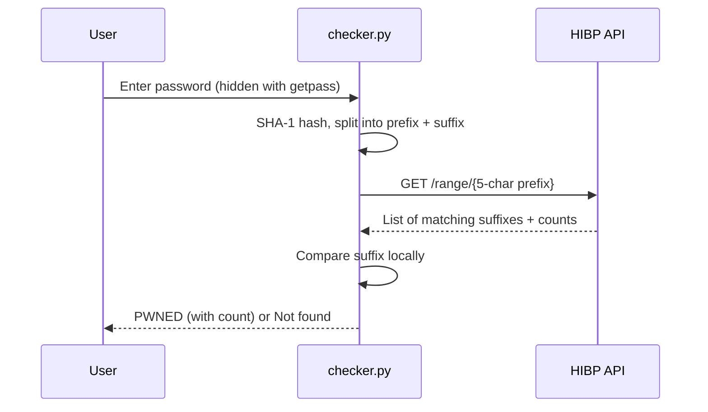

# Password Breach Checker

A command-line tool that checks if a password has shown up in a known data breach, using the Have I Been Pwned Pwned Passwords API. It does this **without ever sending the password, or even its full hash, over the internet**.

## Why I built this

Reused passwords from old breaches are one of the most common ways accounts get taken over (credential stuffing). I wanted to build something that solves a real problem, and to properly understand how a service can check your password without you having to trust it with the password itself.

## How it works

It uses a technique called **k-anonymity**:

1. The password is hashed locally with SHA-1.
2. Only the first 5 characters of the hash (the prefix) are sent to the API.
3. The API sends back every breached hash suffix that starts with that prefix, usually around 1,000 to 2,000 of them, each with a count.
4. The tool compares the rest of the hash against that list **on your machine**.

The API only ever learns the 5-character prefix, which is shared by hundreds of different passwords, so it can't tell which one you checked.



### Why SHA-1?

SHA-1 is broken for things like digital signatures, but here it's only used as a lookup ID to match against the HIBP dataset, not to store passwords. Its collision weakness doesn't matter for this. If you were actually storing passwords, you'd use something like bcrypt or Argon2.

## Security decisions

- **getpass**: the password isn't shown on screen or left in terminal history.
- **No secrets printed**: the hash is never printed, since an unsalted SHA-1 of a weak password can be reversed with a lookup table.
- **Timeout + raise_for_status**: if the API is down or returns an error, the tool reports it instead of wrongly saying "Not found" (a false negative is the worst result for a security tool).

## Usage

Requires Python 3 and the `requests` library.

```bash
pip install requests
python3 checker.py
```

Example:

```
Enter a password to check:
PWNED: seen 52,372,427 times in breach data. Don't use this password.
```

## Tests

```bash
python3 -m unittest -v
```

There are 7 unit tests. The API calls are mocked  with `unittest.mock`, so the tests run without the internet. One test checks that **only the 5-character prefix** is ever passed to the API, which proves the privacy guarantee rather than just claiming it.

## What I learned

- How k-anonymity lets you query sensitive data without revealing it
- The difference between hashing for lookup and hashing for storage
- Handling network errors so a security tool fails safely
- Writing unit tests and mocking external services

## Ideas for future improvements

- Check a list of passwords from a file
- Add the API's `Add-Padding` header so response sizes don't leak information
- Package it as an installable command-line tool
